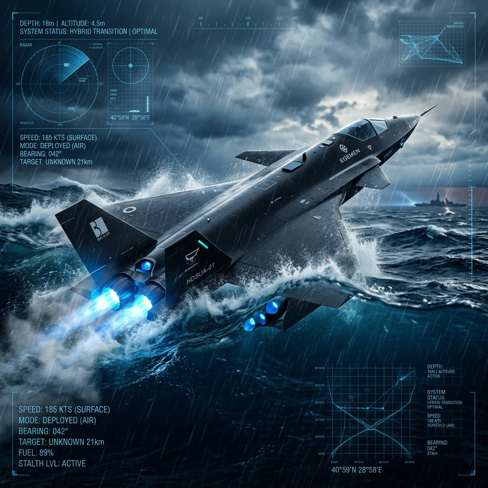
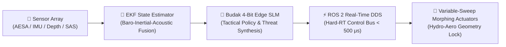

# 🔱 KIZILELMA-H — Trans-Media Autonomous Amphibious UCAV

  
  
  

---

## 🎯 Executive Mission Profile: Dual-Domain Sovereignty

**KIZILELMA-H** is a next-generation **Dual-Domain ("Gök Vatan ⟷ Mavi Vatan") Autonomous Amphibious Unmanned Combat Aerial/Underwater Vehicle (UCAV/UUV)**. Engineered for seamless trans-media lethality, the platform bridges supersonic stratospheric strike capability with silent, deep-water supercavitating infiltration—eliminating the sensor and operational boundary between aerospace and naval warfare.

- **Strategic Deterrence:** Evades radar lock in stratospheric airspace (`Alpha Mode`) and breaks tracking chains by plunging directly into the ocean (`Omega Mode`) without intermediate recovery.
- **Zero-Carrier Projection:** Launches and recovers autonomously from any littoral zone, subsea staging node, or high-altitude corridor.
- **Denied-Environment Survivability:** Operates under total GNSS/RF blackout via onboard neural-inertial navigation and acoustic-optical swarm mesh links.

---

## ⚙️ Operational Parameters & Regime Envelope

| Parameter | ✈️ Alpha Mode (Stratospheric Air) | 🌊 Transition Phase (Hydro-Aero Interface) | 🔱 Omega Mode (Supercavitation Submersible) |
| :--- | :--- | :--- | :--- |
| **Propulsion Architecture** | Dual-Cycle Plasma-Augmented Turbofan | Intake Hermetic Seal & Vector-Thrust Braking | Gas-Injected Supercavitating Hydro-Rocket / Magnetohydrodynamic (MHD) Cruise |
| **Velocity Envelope** | **Mach 2.2** (Supercruise: Mach 1.6) | Entry: `< 110 kt` • Egress Ignition: `0 → Mach 0.8` in `4.2 s` | **85 kt** (Supercavitating Sprint) • **12 kt** (Silent Loiter) |
| **Operational Ceiling / Depth** | **45,000 ft** (`+13,716 m`) | Sea Surface Interface (`0 m` ⟷ `-15 m` Dynamic Buffer) | **-450 m** (Crush Margin: `-600 m` Ti-Matrix Hull) |
| **Low-Observability / Stealth** | **RCS < 0.001 m²** (Active Plasma & Broadband RAM) | Thermal Quench & Splash-Plume Acoustic Suppression | **Acoustic Metamaterial Stealth** (`< 65 dB` Broadband Signature) |
| **Autonomy & Decision Core** | **Egemen-AI Level 5** (BVR Air Combat & SEAD) | Multi-Physics Impact & Attitude Stabilization | **Egemen-AI Level 5** (Subsea Swarm Hunter-Killer) |
| **Sensor & Comms Suite** | AESA Radar • IRST • Laser SATCOM | Millimeter-Wave Altimetry • Cavitation Cone Profiling | Synthetic Aperture Sonar (SAS) • Blue-Green Laser / Acoustic Mesh |

---

## 🧠 Control, Avionics & Morphing Stack

- **`ROS 2 Real-Time DDS`:** Deterministic, zero-copy publish/subscribe middleware running over RTOS-hardened Linux/Xenomai cores with sub-millisecond control loop guarantees (`< 500 μs` jitter) across flight and dive regimes.
- **`Extended Kalman Filter (EKF) Baro-Inertial-Acoustic Fusion`:** 15-state tightly coupled estimator fusing ring-laser gyroscope IMU, barometric altimetry, Doppler Velocity Log (DVL), and hydrostatic pressure sensors for uninterrupted pose continuity across the air-water shock boundary.
- **`Budak 4-Bit Edge SLM`:** Quantized sovereign tactical Small Language/Action Model executing locally on radiation- and pressure-tolerant NPU silicon for zero-latency mission replanning, electronic counter-countermeasures (ECCM), and decentralized wolfpack coordination.
- **`Variable-Sweep Morphing Actuators`:** Electro-hydrostatic smart-alloy wing and control-surface actuators that fold swept delta wings into a high-density hydrodynamic spindle within `1.8 seconds` prior to water impact, while sealing intake ducts against hydrostatic surge.

---

## 🔄 Trans-Media Transition Protocol

1. **Ballistic De-Energy & Geometry Lock (`T - 3.0 s`):** Altimeter radar locks sea-state wave phase; `Variable-Sweep Morphing Actuators` retract primary airfoils, hermetically seal turbofan intakes, and deploy the nose-cone cavitator.
2. **Hydro-Aero Piercing (`T = 0.0 s`):** High-angle pitch-down entry minimizes structural G-load; boundary-layer gas ejection envelops the fuselage in a low-drag vapor cavity, transitioning the EKF state vector from aerodynamic to hydrodynamic coefficients.
3. **Subsea Ballistic Egress (`Omega ➔ Alpha`):** Compressed-gas broach thrusters eject the hull through the surface at a `65°` vector; plasma igniters purge water from main ducts and ignite afterburners in `< 1.2 seconds` for immediate supersonic climb.

---

> *"Future theater dominance belongs to platforms that treat the sea surface not as a floor, but as a tactical concealment layer."*

**Architected by Bahattin Yunus Çetin | 2026 Sovereign Systems Initiative**

**[⬅️ Return to Command Center](README.md)**
