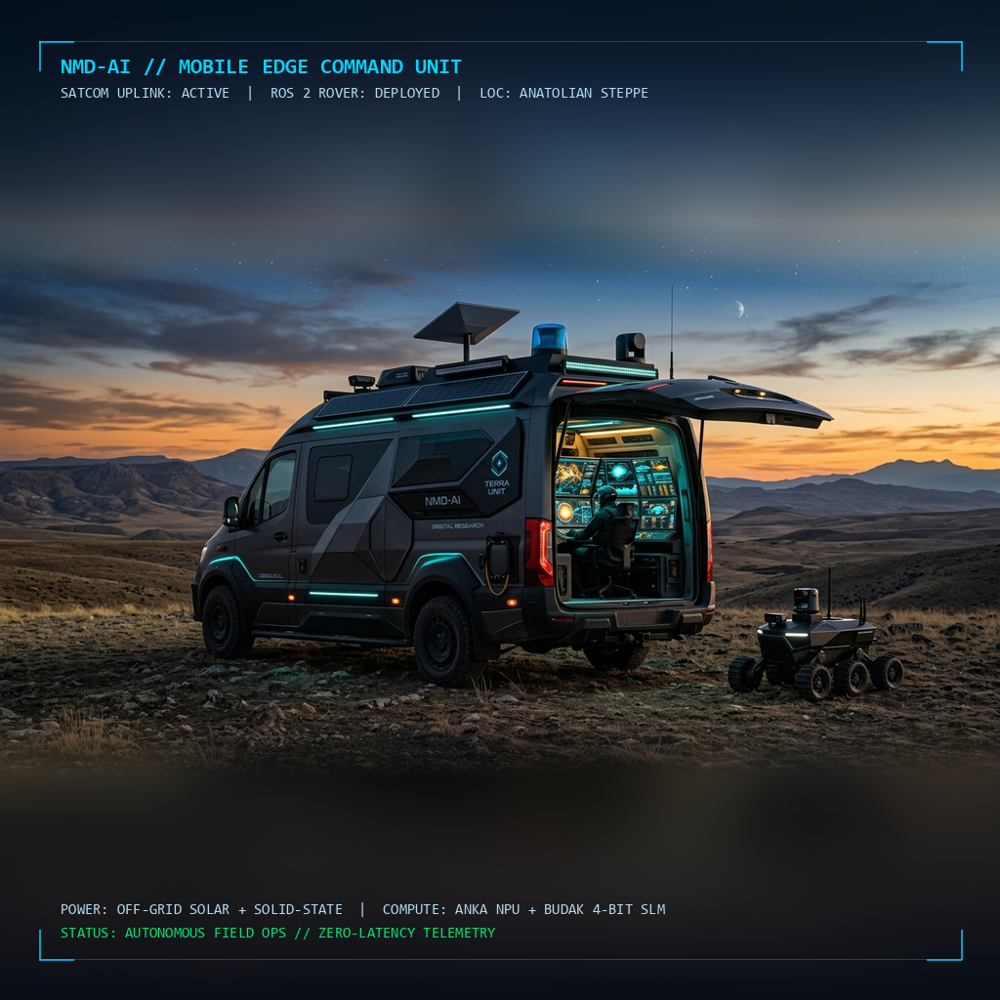

# 🚐 NMD-AI // NOMADIC EDGE LAB & STEPPE ROVER FIELD OPS

> **"Zero Cloud. Full Sovereignty. Deep-Tech Field Operations Across the Anatolian Steppe."**

## 🎯 Mission Vision: Sovereign Off-Grid Command
**NMD-AI (Nomadic Edge Lab)** is an autonomous, off-grid mobile research and tactical C4ISR platform engineered for austere deployments across the Anatolian steppe and contested environments. Designed to operate indefinitely without external infrastructure, grid power, or commercial cloud reliance, NMD-AI fuses high-density edge compute, wideband spectrum intelligence (`Kıyamet-Hattı`), and unmanned ground reconnaissance (`ROS 2 Steppe Rover`) into a single ruggedized mobile fortress.

---

## 🛠️ Technical Specifications (Field Ops Matrix)

| Subsystem | Architecture / Hardware | Operational Capability | Status |
| :--- | :--- | :--- | :---: |
| **Edge AI Cluster** | Dual-Node `NVIDIA Jetson Orin` + `Anka RISC-V` Rack | Local `Budak 4-bit QLoRA` LLM Inference • `550 TOPS` Air-Gapped | 🟢 **Active** |
| **Comms & SIGINT (`Kıyamet-Hattı`)** | Phased-Array LEO SatCom • `SDR` Wideband • `DMR/FT8` | `100 kHz – 6 GHz` `FFT/ELINT` Waterfall • `NOAA` APT/LRPT Decoder | 🟢 **Nominal** |
| **Steppe Rover (`ROS 2`)** | 6x6 Active-Suspension UGV • `3D LiDAR` • `IMU` | `EKF` GPS-Denied SLAM • `Nav2` Autonomy • `MAVLink` Sync | 🟢 **Field-Ready** |
| **Power & Autonomy** | Deployable Solar Array + `LiFePO4` Solid-State Bank | `12.8 kWh` Storage • `2.4 kW` Peak Solar • 100% Off-Grid Continuous | 🟢 **Autonomous** |

---

## 🏗️ Core Subsystem Architecture

### 🧠 1. Mobile Compute & Edge AI Cluster
- **Air-Gapped Neural Processing:** Dual ruggedized `NVIDIA Jetson AGX Orin` nodes paired with custom `Anka RISC-V` co-processing blades housed in a shock-isolated server rack.
- **Sovereign Local LLMs:** Executes `Budak 4-bit QLoRA` quantized large language models, local RAG pipelines, and real-time multi-spectral computer vision with **zero cloud dependency**.

### 📡 2. Off-Grid Comms & SIGINT Array (`Kıyamet-Hattı`)
- **Multi-Band Spectrum Dominance:** Roof-mounted auto-tracking phased-array LEO SatCom dish integrated with a wideband Software-Defined Radio (`SDR`) waterfall receiver for real-time `FFT / ELINT` signal classification.
- **Resilient Mesh & Orbital Telemetry:** Redundant `DMR / FT8` HF/VHF emergency mesh transceivers for blackout scenarios, alongside automated `NOAA` and `Meteor-M` orbital APT/LRPT weather telemetry decoding.

### 🤖 3. Autonomous Steppe Rover (`ROS 2`)
- **All-Terrain Reconnaissance:** 6-wheeled active-suspension robotic scout deployed from the vehicle's rear bay for hazardous perimeter sweeps, relay placement, and geological/biosignal sampling.
- **GPS-Denied Navigation:** Powered by `ROS 2 Humble/Iron`, utilizing multi-sensor fusion via an `Extended Kalman Filter (EKF)` combining `3D LiDAR`, visual odometry, and tactical IMU data through the `Nav2` stack with dual umbilical/wireless `MAVLink` telemetry sync.

### ⚡ 4. Power & Autonomy Matrix
- **Infinite Steppe Endurance:** High-efficiency roof-mounted foldable solar array coupled with a thermally managed `LiFePO4` solid-state battery bank and smart MPPT bus controller, guaranteeing continuous 24/7 operation of the compute cluster, radar/SDR array, and rover charging dock.

---

> *"True technological sovereignty is measured when the grid goes dark. NMD-AI carries the laboratory, the satellite link, and the neural core into the heart of the steppe."*

**Developed by bahattinyunus | 2026 Sovereign Systems Initiative**

**[⬅️ Return to Command Center](README.md)**
