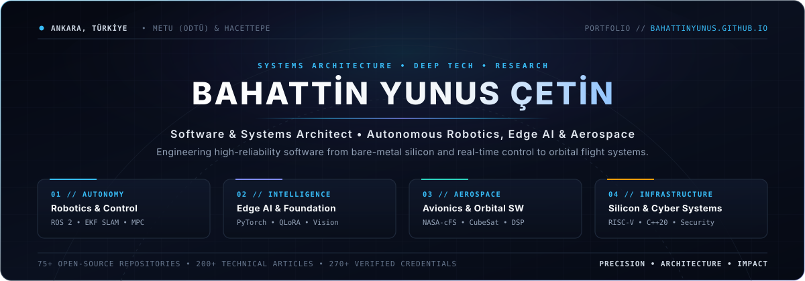
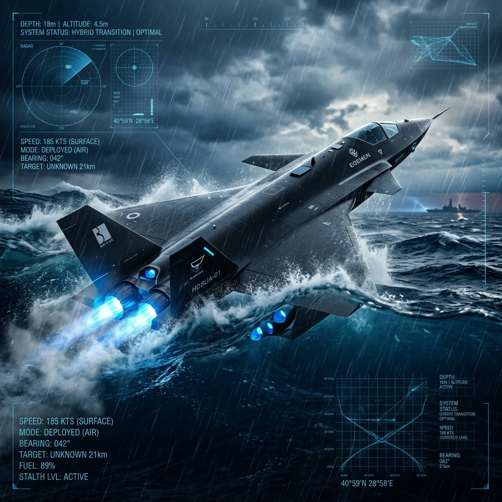
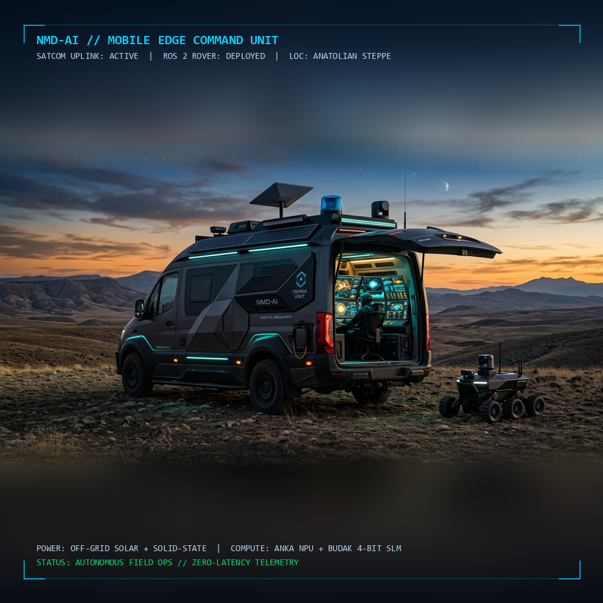
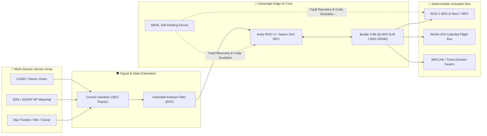
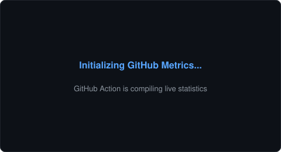
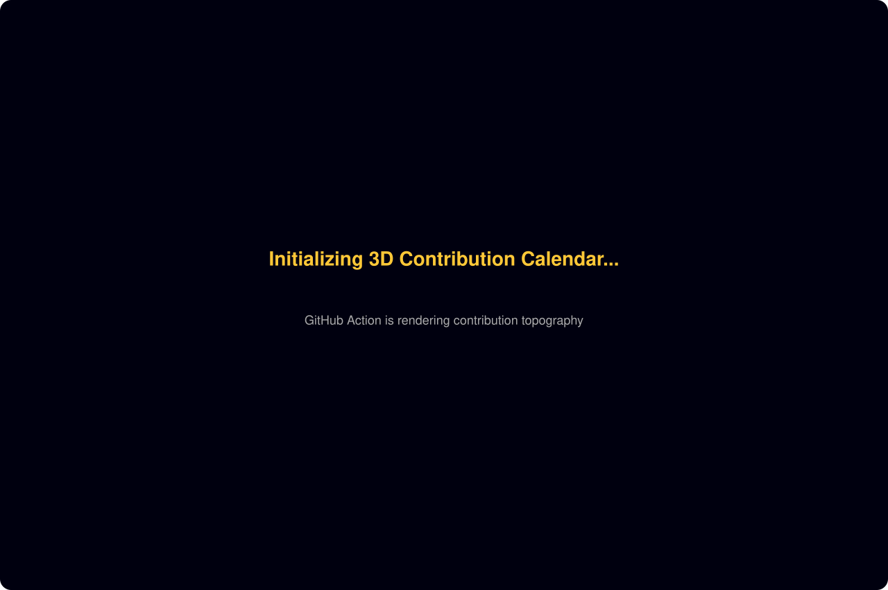
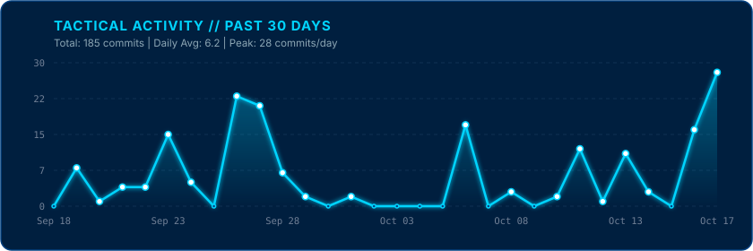
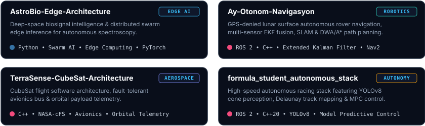

 

  

    

  

    
  

  

    
    
    
    
    
    
  

  

    <a href="#-command-structure--rd-ventures"><code>[ 🏛️ Ventures & R&D ]</code></a> •
    <a href="#-flagship-architectures-2026-core-initiatives"><code>[ 🚀 2026 Flagships ]</code></a> •
    <a href="#-strategic-systems-matrix"><code>[ 📂 Systems Matrix ]</code></a> •
    <a href="#-production-grade-technical-arsenal"><code>[ 🛠️ Tech Stack ]</code></a> •
    <a href="#-analytical-intelligence--system-metrics"><code>[ 📊 Telemetry ]</code></a> •
    <a href="#-academic-architecture--verified-credentials"><code>[ 🎓 Credentials ]</code></a>
  

---

## 🏛️ Command Structure & R&D Ventures

> *"Geleceği tahmin etmenin en güvenilir yolu, onu bizzat inşa etme iradesini göstermektir."*
>
> **Architectural Thesis:** Moving beyond cloud-dependent AI consumption to engineer **sovereign, low-latency Edge-AI, autonomous robotic control stacks (ROS 2 / C++20), and resilient cyber-physical architectures** capable of operating under deterministic real-time and contested-environment constraints.

| Venture / Initiative | Executive Role | Architectural Focus & Technical Mandate |
| :--- | :--- | :--- |
| **🔬 MERL** *(Meta-Engineering Research Lab)* | **Lead Researcher & Founder** | **Self-Healing & Autonomous Systems:** Autonomous code evolution, cognitive bottleneck elimination, and fault-tolerant software organisms. |
| **📱 Budak** *(Edge-AI Optimization)* | **Founder & Optimization Architect** | **Zero-Latency Edge Intelligence:** Model pruning, quantization (`QLoRA`), and knowledge distillation delivering up to **80% footprint compression** for industrial IoT & autonomous platforms. |
| **🦅 Anka Silicon Dynamics** | **Founder & Chief Architect** | **Silicon-Ready SLMs:** Co-designing Small Language Models (`vLLM` / `CUDA` / `NPU-FPGA`) and morphologically aware Turkish tokenization for sovereign hardware acceleration. |
| **🛡️ Siber Vatan** *(T-Red Team Operations)* | **Offensive & Defensive Cyber** | **Asymmetric Cyber Defense:** Red teaming, reverse engineering (`Ghidra`/`Radare2`), malware forensics, and critical infrastructure `DevSecOps` hardening. |

  📄 Full operational history & doctrine: <a href="./BIOGRAPHY.md"><b>Read Strategic Dossier (BIOGRAPHY.md) →</b></a>

---

## 🚀 Flagship Architectures (2026 Core Initiatives)

| System / Blueprint | Domain & Mission Profile | Core Engineering Stack | Operational Status |
| :--- | :--- | :--- | :---: |
| **[AstroBio-Edge](https://github.com/bahattinyunus/AstroBio-Edge-Architecture)** | Deep-Space Biosignal & Spectroscopy Intelligence | `Swarm AI` `Edge Computing` `PyTorch` | 🟢 **Active** |
| **[Ay-Otonom](https://github.com/bahattinyunus/Ay-Otonom-Navigasyon)** | GPS-Denied Lunar Surface Autonomous Navigation | `ROS2` `EKF` `SLAM Toolbox` `Nav2` | 🟢 **Nominal** |
| **[Feza-X / TerraSense](https://github.com/bahattinyunus/TerraSense-CubeSat-Architecture)** | Aethel-Class CubeSat Flight Software & Avionics | `NASA-cFS` `C++` `Orbital Telemetry` | 🟢 **Nominal** |
| **[Cosmic-Sanitizer](https://github.com/bahattinyunus/Cosmic-Telemetry-Sanitizer)** | Radiation-Induced SEU Telemetry Integrity Stack | `Kalman Filter` `SEU Repair` `Anomaly AI` | 🟢 **Production** |
| **[MilliHaklar](https://github.com/bahattinyunus/MilliHaklar-UzayHukuku)** | Orbital Situational Awareness & Space Law AI | `SSA Data` `Legal-AI` `RAG` | 🟢 **Deployed** |
| **[Aura-Hockey-AR](https://github.com/bahattinyunus/Aura-Hockey-AR)** | Real-Time Spatial Hand-Tracking 3D Engine | `MediaPipe` `Three.js` `Computer Vision` | 🟢 **Verified** |
| **[TurkSpace-Platform](https://github.com/bahattinyunus/TurkSpace-Platform)** | Space-as-a-Service (SpaaS) Mission Dashboard | `Space Data` `Telemetry UI` `Full-Stack` | 🟢 **Nominal** |
| **[KIZILELMA-H Spec](./KIZILELMA_H_SPEC.md)** | Hybrid Submersible Unmanned Combat Aircraft | `Egemen-AI` `Trans-Media Hydro/Aero` | 🔵 **Spec Blueprint** |
| **[SUNGUR-OMNI Spec](./SUNGUR_OMNI_SPEC.md)** | Multi-Domain Autonomous Platform (Sea/Land/Space) | `Omni-AI` `Tri-Propulsion` `Swarm` | 🟣 **Visionary Spec** |

 

### 🌌 Trans-Domain Visual Dossier & Field Operations

| 🔱 **KIZILELMA-H // Hydro-Aero Stealth Platform** | 🌐 **SUNGUR-OMNI // Multi-Domain ROS 2 Mesh** |
| :---: | :---: |
|  **Mach 2.2 Stratospheric Flight ⟷ 85 kt Supercavitation Submersible** • [Read Spec Sheet →](./KIZILELMA_H_SPEC.md) |  **Unified Sea / Land / Air / Deep-Space Autonomous Control Bus** • [Read Spec Sheet →](./SUNGUR_OMNI_SPEC.md) |
| 🛰️ **MERL & FEZA-X // Orbital & Neural Command** | 🚐 **NOMADIC EDGE LAB // Anatolian Steppe Ops** |
|  **Self-Healing Neural Topologies & Telemetry Command** • [Read Dossier →](./BIOGRAPHY.md) |  **Off-Grid Mobile Edge Data Center, SatCom & Steppe Rover** • [Explore Kıyamet-Hattı →](https://github.com/bahattinyunus/Kiyamet-Hatti) |

 

### 🧬 Sovereign Cyber-Physical Control Loop (System Architecture)

---

<!-- START_QUOTE -->
## ⚖️ Architectural Logic & Visionary Principles

> *“Gökyüzüne bakmayanların yeryüzünde göreceği bir şey yoktur. - Ali Kuşçu”*

- **System Strategy**: Geçmişin hatası, geleceğin rehberidir. - Gazali
- **Operational Integrity**: Sakin bir zihin, en güçlü kalkandır. - Marcus Aurelius
- **Architectural Vision**: Ya olduğun gibi görün, ya göründüğün gibi ol. - Mevlâna
- **Logic & Reason**: Zorlukların ortasında fırsatlar yatar. - Albert Einstein
<!-- END_QUOTE -->

---

## 📂 Strategic Systems Matrix

<b>🤖 1. Robotics, Autonomous Control & Unmanned Systems</b>

 

| Repository | Mission & Engineering Scope | Core Stack |
| :--- | :--- | :--- |
| **[Ay-Otonom-Navigasyon](https://github.com/bahattinyunus/Ay-Otonom-Navigasyon)** | Autonomous lunar rover localization, sensor fusion & path planning | `ROS2` `EKF` `DWA` `A*` |
| **[Formula Student Autonomous](https://github.com/bahattinyunus/formula_student_autonomous_stack)** | High-speed perception, cone detection & Model Predictive Control | `ROS2` `YOLOv8` `MPC` `C++` |
| **[ERC Rover GCS](https://github.com/bahattinyunus/erc_rover_mission_control)** | European Rover Challenge ground control station & digital twin | `Digital Twin` `Edge AI` `Telemetry` |
| **[Robotex Warrior Core](https://github.com/bahattinyunus/robotex_warrior_core)** | Deterministic low-latency combat/autonomous robotics core | `C++20` `EKF` `DDS` `RTOS` |
| **[LionSight AUV](https://github.com/bahattinyunus/LionSight-AUV)** | Autonomous Underwater Vehicle vision & acoustic navigation stack | `Jetson Orin` `PyTorch` `ROS2` |
| **[AQUASYNC](https://github.com/bahattinyunus/AQUASYNC-Multi-Domain-Autonomous-Maritime-System)** | Multi-domain cooperative maritime swarm orchestration | `Swarm` `Nav2` `MAVLink` |
| **[Robotaksi Full-Stack](https://github.com/bahattinyunus/teknofest_robotaksi)** | TEKNOFEST full-scale autonomous vehicle lateral/longitudinal control | `Stanley` `Pure Pursuit` `ROS2` |

<b>🧠 2. Edge-AI, Large Language Models & Neural Architectures</b>

 

| Repository | Mission & Engineering Scope | Core Stack |
| :--- | :--- | :--- |
| **[AstroBio-Edge](https://github.com/bahattinyunus/AstroBio-Edge-Architecture)** | Distributed swarm inference for astrobiological spectral analysis | `Swarm AI` `Edge Computing` `Spectroscopy` |
| **[Cosmic-Sanitizer](https://github.com/bahattinyunus/Cosmic-Telemetry-Sanitizer)** | Deep anomaly detection & Kalman smoothing for corrupted sensor streams | `Kalman Smoothing` `Anomaly Detection` |
| **[Akademik Radar](https://github.com/bahattinyunus/AkademikRadar)** | Scientific literature knowledge graph & semantic discovery engine | `SciBERT` `Graph Theory` `NLP` |
| **[Nexus TRL](https://github.com/bahattinyunus/Nexus-TRL-LLM)** | LLM-driven Technology Readiness Level assessment & R&D intelligence | `LLM` `RAG` `Data Analysis` |
| **[NexusBroker](https://github.com/bahattinyunus/NexusBroker)** | Decentralized autonomous brokerage with vector memory & smart contracts | `Vector DB` `Solidity` `AI Agents` |
| **[DeepAntenna](https://github.com/bahattinyunus/ANN-for-Antenna-Design)** | Neural surrogate modeling for RF & microstrip antenna optimization | `TensorFlow` `ANN` `Electromagnetics` |

<b>🛡️ 3. Aerospace, SIGINT, Mission-Critical & Cybersecurity</b>

 

| Repository | Mission & Engineering Scope | Core Stack |
| :--- | :--- | :--- |
| **[Feza-X (CubeSat)](https://github.com/bahattinyunus/TerraSense-CubeSat-Architecture)** | Flight software bus, fault management & payload orchestration | `NASA-cFS` `Aethel-Class` `CubeSat` |
| **[RedPlanet-Habitat](https://github.com/bahattinyunus/RedPlanet-Autonomous-Habitat)** | Closed-loop life support & planetary habitat operating system | `Habitat OS` `Cyber-Physical` |
| **[Otonom-İstasyon](https://github.com/bahattinyunus/Otonom-Moduler-Istasyon)** | Orbital station docking dynamics (Clohessy-Wiltshire) & defense | `Orbital Mechanics` `CW-Dynamics` |
| **[Kıyamet-Hattı](https://github.com/bahattinyunus/Kiyamet-Hatti)** | Off-grid emergency radio, satellite & tactical mesh communication | `SDR` `DMR/FT8` `SatCom` |
| **[SIGINT HUB](https://github.com/bahattinyunus/SIGINT)** | Signal Intelligence, spectral waterfall analysis & RF classification | `DSP` `FFT` `ELINT` `SDR` |
| **[NOAA Station](https://github.com/bahattinyunus/NOAA)** | Automated meteorological satellite APT/LRPT ground station decoder | `Orbital` `Signal Processing` |
| **[Digital Archaeology Vault](https://github.com/bahattinyunus/Digital-Archaeology-Steganography-Vault)** | Cryptographic steganography & digital forensics analysis suite | `Forensics` `Steganography` `Crypto` |
| **[Milli Teknoloji Envanteri](https://github.com/bahattinyunus/Milli-Teknoloji-Envanteri)** | Sovereign defense & deep-tech capability mapping platform | `Strategy` `TRL` `Analytics` |

<b>🏗️ 4. Silicon, Industrial IIoT & Digital Twin Ecosystems</b>

 

| Repository | Mission & Engineering Scope | Core Stack |
| :--- | :--- | :--- |
| **[ANATOLIA-SILICON](https://github.com/bahattinyunus/ANATOLIA-SILICON)** | Open-source processor architecture & sovereign semiconductor R&D | `RISC-V` `RTL` `Computer Architecture` |
| **[Industrial Intelligence](https://github.com/bahattinyunus/teknofest_sanayide_dijital_teknolojiler)** | Predictive maintenance, factory IIoT telemetry & digital twin | `IIoT` `Digital Twin` `MQTT` |
| **[CivTech-Core](https://github.com/bahattinyunus/CivTech-Core)** | Finite Element Method (FEM) structural simulation & generative design | `FEM` `Generative Design` `Simulation` |
| **[CodeVisualizer](https://github.com/bahattinyunus/CodeVisualizer)** | Abstract Syntax Tree (AST) static analysis & interactive architecture graph | `AST` `React` `FastAPI` |
| **[NovaChat](https://github.com/bahattinyunus/NovaChat-Real-Time-Messaging-App)** | Low-latency distributed pub/sub real-time communication engine | `Socket.IO` `Redis` `Node.js` |

---

## 🛠️ Production-Grade Technical Arsenal

| ⚙️ Systems, Robotics & Edge Core | 🧠 AI, LLM Ops & Computer Vision |
| :---: | :---: |
|    `C++20` • `ROS 2 (Nav2 / DDS)` • `NASA-cFS` • `MAVLink` • `RISC-V` • `SDR / DSP` • `Jetson Orin` |    `vLLM` • `QLoRA / Unsloth` • `Knowledge Distillation` • `YOLOv8` • `MediaPipe` • `Kalman / EKF` • `RAG` |

 

| 🛡️ Cyber, Cloud-Native & DevSecOps | 🌐 Full-Stack Telemetry & Data |
| :---: | :---: |
|    `Offensive Security (Red Team)` • `Reverse Engineering (Ghidra)` • `Zero-Trust` • `ISO/IEC 27001` • `CI/CD` |    `Mission Control GCS` • `3D Spatial Web (Three.js)` • `Vector DBs (Milvus/Pinecone)` • `WebSockets` |

---

## 📊 Analytical Intelligence & System Metrics

  

 

  <picture>
    <source media="(prefers-color-scheme: dark)" srcset="./profile-3d-contrib/profile-night-rainbow.svg" />
    <source media="(prefers-color-scheme: light)" srcset="./profile-3d-contrib/profile-green-animate.svg" />
    
  </picture>

 

  

 

  

 

  

---

## 🎓 Academic Architecture & Verified Credentials

  
  
  
  

 

### 🏛️ Academic Foundation

| Institution | Academic Focus & Track | Period | Status |
| :--- | :--- | :---: | :---: |
| **[Hacettepe Üniversitesi](https://www.hacettepe.edu.tr/)** | Multi-Disciplinary Academic & Research Track | `2026 – 2028` | 🟢 **Active** |
| **[Karadeniz Teknik Üniversitesi (KTÜ)](https://www.ktu.edu.tr/)** | Software Engineering & Systems Architecture | `2023 – 2026` | ⚪ **Alum** |
| **[Recep Tayyip Erdoğan Üniversitesi (RTEÜ)](https://erdogan.edu.tr/)** | Distributed Academic & Laboratory Track | `2024 – 2026` | ⚪ **Alum** |

### 🏅 Selected Executive Licenses & Hackathons

| Credential / Honor | Issuing Authority | Verification / ID |
| :--- | :--- | :--- |
| **İHA-1 (UAV-1) Commercial/Sport Pilot License** | SHGM (Directorate General of Civil Aviation) | `TR-IHA1H10609053` |
| **ISO/IEC 27001 Information Security Lead Auditor** | Information Security & Compliance | `Verified Auditor` |
| **TUA Astro Hackathon & Interstellar Problem Solver** | Türkiye Uzay Ajansı (Turkish Space Agency) | `Mar – Apr 2026` |
| **5-Day White Hat Hacker Bootcamp & Cyber Defense** | Siber Vatan / DOKA / Bilgi Güvenliği Derneği | `Mar – May 2026` |
| **Ankara AI Hackathon** | Teknopark Ankara | `jeqDhGDaZKq` |
| **Aviation & Space Exploration Camp** | TÜBİTAK | `Nov 2025` |

<b>📜 Complete Verification Ledger — All Licenses & Certifications (266+ Chronological Archive)</b>

 

| Date | Certification Name | Institution | Credential ID |
| :--- | :--- | :--- | :--- |
| Haz 2026 | HTML5 & CSS3 – Ders 3 | Bilgeİş | ad616b65-53ef-4c5d-9b8f-00cd6cf1fa43 |
| Haz 2026 | HTML5 & CSS3 – Ders 2 | Bilgeİş | b100b204-76e2-4968-a82a-8d8e4c9950c9 |
| Haz 2026 | HTML5 & CSS3 – Ders 1 | Bilgeİş | a3e692f7-e470-47ad-85f6-a1af0bccf3af |
| Haz 2026 | Web Tasarımının Temelleri HTML ve CSS | Bilgeİş | e4492f1b-9f9c-4291-bd36-1bc6dc72e30b |
| Haz 2026 | Wordpress Kullanarak Web Sitesi Hazırlama | Bilgeİş | 18e5f0bd-5721-46ed-8f12-e5c93e11634e |
| Haz 2026 | 3 Boyutlu Yazıcı Teknolojisine Giriş | Bilgeİş | b08b003f-50e0-4f79-a199-9d85cade4648 |
| Haz 2026 | 3 Boyutlu Yazıcıların Farklı Sektörlerde Kullanımı | Bilgeİş | b1a13948-40a1-4fda-8dd7-0736391023d1 |
| Haz 2026 | Vitrin Tasarımı | Bilgeİş | 89ad6ed9-3c6a-44bb-8027-7579afd594ac |
| Haz 2026 | Yiyecek İçecek Servisi | Bilgeİş | 7d1be7d6-69f3-4c1a-943f-f9eec417fba8 |
| Haz 2026 | Proje Yönetimi Hakkında Temel Bilgiler | Bilgeİş | 581745ed-d71c-4b14-b7a1-3d43724a4a09 |
| Haz 2026 | KOBİ’lerde Kurumsallaşma ve İstikrar İçin Markalaşma | Bilgeİş | da40a586-e522-4c2d-bdbd-fd64903e86fb |
| Haz 2026 | Raspberry Pi ile İleri Seviye | Bilgeİş | e204fb6e-f7f0-4c40-885a-52420fd8495b |
| Haz 2026 | İnovasyon | Bilgeİş | b99b5662-dd06-477e-b89b-bcb693cd11d3 |
| Haz 2026 | Python Programlama - 1 | Bilgeİş | 38c4e588-048f-4834-9f24-91bc413c9b2c |
| Haz 2026 | Web Konferans Araçlarına Ait Temel Kavramlar ve Başlıca Avantajlar | Bilgeİş | f0c789ea-1750-40e1-acd2-aced9ca5226e |
| Haz 2026 | Proje Yönetimi Yazılımı - PROJECTLIBRE | Bilgeİş | 5ebac33d-1054-4459-a83d-010e69775a4f |
| Haz 2026 | Çevrim İçi Form Oluşturma | Bilgeİş | b9c90eb6-ac35-452a-90bb-999f3abd3ab0 |
| Haz 2026 | Odoo (OpenERP) Entegre İş Yönetim Uygulaması | Bilgeİş | 244eeb65-b2a9-4f30-bced-cc5092376d13 |
| Haz 2026 | İşe Alım Süreci | Bilgeİş | 96547836-21cf-4d06-a1b3-58cc4679fd53 |
| Haz 2026 | Google Slaytlar İle Etkili Sunum Hazırlama | Bilgeİş | a46225b5-0c02-44cb-82c6-75f8416a57a1 |
| Haz 2026 | Arduino ile Mikrodenetleyiciler 2 (GirişÇıkış Arayüzleri) | Bilgeİş | 4915324a-9e0d-45be-a381-370f50040b08 |
| Haz 2026 | KOBİ'ler İçin Kalite Belgelendirme Süreçleri | Bilgeİş | f06bba99-7efb-4ed8-bb54-8421de207149 |
| Haz 2026 | KOBİ'lerin Yararlanabileceği Destekler | Bilgeİş | 6a8a393c-8c51-4bae-b8ed-729f4e2681f3 |
| Haz 2026 | Dış Ticaret | Bilgeİş | 6ee13768-9902-4e99-940a-bc1eb52dc5ae |
| Haz 2026 | Python Programlama - 2 | Bilgeİş | ffba9a75-e00f-4041-aee2-3667594325d1 |
| Haz 2026 | KOBİ’lerin Bilgi ve İletişim Teknolojileri Deneyimleri | Bilgeİş | f75cc449-a64a-40f0-a499-e9eb4613c3be |
| Haz 2026 | GİRİŞİMCİLİK Göknur ATALAY | TBD TÜRKİYE BİLİŞİM DERNEĞİ | 0a42b103-3f6b-4c2b-a9ac-4d524da87ff1 |
| Haz 2026 | GİRİŞİMCİLİK Nazlı AKYAY | TBD TÜRKİYE BİLİŞİM DERNEĞİ | 53cc0f9c-1481-44fb-a9e6-1f63861e5135 |
| Haz 2026 | GİRİŞİMCİLİK Ayşe Kuyrukcu | TBD TÜRKİYE BİLİŞİM DERNEĞİ | 4c4982fa-6abb-41b6-925c-d65ed8019582 |
| Haz 2026 | Herkes için Yapay Zeka I | Bilgeİş | 9b675ab7-bab4-44c2-aba3-d86678a0d68d |
| Haz 2026 | Arduino ile Mikrodenetleyiciler 3 (Sensörden Veri Okuma) | Bilgeİş | a02aa4b3-ff7d-4359-9cbe-00bc4f4f44e6 |
| Haz 2026 | CSS | Bilgeİş | 9078c781-b170-433c-9087-e6af96cd5aaa |
| Haz 2026 | Arduino ile Mikrodenetleyicilere Giriş | Bilgeİş | ada8e3c4-6aa1-4ef7-9468-61c55038b01b |
| Haz 2026 | SOSYAL MEDYA | TBD TÜRKİYE BİLİŞİM DERNEĞİ | 19897818-7319-4ca5-b9db-63d579b04551 |
| Haz 2026 | SATIŞ VE PAZARLAMA | TBD TÜRKİYE BİLİŞİM DERNEĞİ | b35223a5-5755-4776-b05b-6c6d3f070cf9 |
| Haz 2026 | HUKUKİ MEVZUAT Yiğit Gökçen | TBD TÜRKİYE BİLİŞİM DERNEĞİ | 3468eb1e-b45b-472a-95f5-be5f7c175d30 |
| Haz 2026 | HUKUKİ MEVZUAT Çiğdem Çamurdan | TBD TÜRKİYE BİLİŞİM DERNEĞİ | ac639136-d72d-4d97-9bb6-6681fe94d394 |
| Haz 2026 | DİJİTAL PAZARLAMA YÖNTEMLERİ | TBD TÜRKİYE BİLİŞİM DERNEĞİ | 5b889697-dd18-4ad2-960f-f62dd8f630c0 |
| Haz 2026 | BİLGİ GÜVENLİĞİ | TBD TÜRKİYE BİLİŞİM DERNEĞİ | f224f9b7-ce1e-4332-a54e-40115f18946e |
| Haz 2026 | HTML | Bilgeİş | 2065904d-1057-4c69-b552-cd81e538fc51 |
| Haz 2026 | İş Yerinde Psikolojik Taciz (Mobbing) | Bilgeİş | fb35c3d6-37c7-4b28-8142-ebf8db9fcf05 |
| Haz 2026 | Ofiste Sağlıklı Yaşam | Bilgeİş | f048ca63-a61b-4457-aad2-aafb508e0aad |
| Haz 2026 | İlk Yardım | Bilgeİş | 633a4680-cbc2-4719-8f34-8790b65e40bf |
| Haz 2026 | Erişilebilir İş Yeri Tasarımı | Bilgeİş | 77b1ca12-556e-4b36-8105-27aaaf7d00dd |
| Haz 2026 | Dronelar ve Ticari Amaçlı Kullanımları | Bilgeİş | 63a5b6cd-8829-4e1c-8e7a-0328518e9dc4 |
| Haz 2026 | Güneş Enerjisinden Yararlanma | Bilgeİş | 76b9e099-84cb-4ed7-9119-2036e41ae412 |
| Haz 2026 | KOBİ’ler İçin Sanal Gerçeklik | Bilgeİş | 3b6c9092-b762-486d-ad41-7f607a2627cd |
| Haz 2026 | Yeni Başlayanlar İçin Raspberry Pi | Bilgeİş | fc6a2f8b-029c-4aaf-80f6-5b7594e90aa8 |
| Haz 2026 | Prompt Mühendisliği | Turkcell Geleceği Yazanlar | — |
| Haz 2026 | Robotik Programlama | Bilgeİş | 9f46b3f5-5dc3-49b6-9435-999214405d89 |
| Haz 2026 | Temel Elektronik | Bilgeİş | f0bda3dc-c410-4ff7-b699-9c3c9a161ff7 |
| Haz 2026 | Javascript | Bilgeİş | 00dee6f8-1e4c-44d6-9530-92a397c70bcc |
| May 2026 | KOBİ’ler İçin Fikri Mülkiyet Hakları | Bilgeİş | 6485390c-381b-4e78-aeec-634879114b74 |
| May 2026 | Teknoloji ve Verimliliğin Anahtarı Yenilikçi Firmalar | Bilgeİş | 05b9ff0f-5bf1-42b4-bd8f-789734134a67 |
| May 2026 | İnternette Güvenliğinizi Arttırın | Bilgeİş | b68d9857-fae2-4100-800d-a2f99c6b4a00 |
| May 2026 | Şikayet Yönetimi | Bilgeİş | 8fefbcd1-c76d-444b-8d0a-22b64eab404b |
| May 2026 | Kurumlarda Stres Yönetimi | Bilgeİş | 8e2b7e9f-ba74-489e-856e-dc0d1edf1e76 |
| May 2026 | İşiniz İçin Sosyal Medya | Bilgeİş | 8c75eedb-cfde-434a-921b-6688970bb107 |
| May 2026 | Genel İş Sağlığı ve Güvenliği | Bilgeİş | 0ea58e7a-b577-4708-9cc9-8288f876dba4 |
| May 2026 | Tasarım Odaklı Düşünme'ye Giriş | Bilgeİş | 65789142-d220-4067-b5b3-aa91c80e4d35 |
| May 2026 | Zor İnsanlarla Baş Etme | Bilgeİş | fa215315-706d-45d2-903c-fd667626a43d |
| May 2026 | Programlamanın Temelleri | Bilgeİş | 0276249b-a986-4f67-be92-fc882e1468d5 |
| May 2026 | Kişisel Stres Yönetimi | Bilgeİş | 6488a577-e9fc-485b-829c-839d71c55f44 |
| May 2026 | Liderlik | Bilgeİş | 4f43acef-7ec0-48c0-a9ee-c67af2f10072 |
| May 2026 | Uygulamalı Kaggle | BTK Akademi | nKqhnLg2Xk |
| May 2026 | Bulut Bilişim Mimarileri | BTK Akademi | 8jmhNYGW1m |
| May 2026 | Microsoft Word Temelleri | BTK Akademi | mKEhkdwO6L |
| May 2026 | Adli Bilişime Giriş | BTK Akademi | dx1hla67nb |
| May 2026 | Python Programlama 301 | Turkcell Geleceği Yazanlar | — |
| May 2026 | Python Programlama 201 | Turkcell Geleceği Yazanlar | — |
| May 2026 | Python Programlama 101 | Turkcell Geleceği Yazanlar | — |
| May 2026 | 402: MongoDB | Turkcell Geleceği Yazanlar | — |
| May 2026 | 401: Node.js | Turkcell Geleceği Yazanlar | — |
| May 2026 | 302: JQuery | Turkcell Geleceği Yazanlar | — |
| May 2026 | 301: JavaScript | Turkcell Geleceği Yazanlar | — |
| May 2026 | 201: HTML5 & CSS | Turkcell Geleceği Yazanlar | — |
| May 2026 | Temel Linux 101 | Turkcell Geleceği Yazanlar | — |
| May 2026 | Arduino 101 | Turkcell Geleceği Yazanlar | — |
| May 2026 | Yazılım Geliştirme Araçları | BTK Akademi | jK1hKXNyYr |
| May 2026 | Veri Bilimi ve Yapay Zekaya Giriş | Turkcell Geleceği Yazanlar | — |
| May 2026 | İnsansız Hava Aracı | T3 Akademi | — |
| May 2026 | Veri Okuryazarlığı | Turkcell Geleceği Yazanlar | — |
| May 2026 | Python Programlama | T3 Akademi | — |
| May 2026 | 101: HTML | Turkcell Geleceği Yazanlar | — |
| May 2026 | Roket | T3 Akademi | — |
| May 2026 | Girişimci Yetiştirme Programı | T3 Girişim Merkezi | — |
| May 2026 | E-Ticaret ve SEO | T3 Akademi | — |
| May 2026 | Siber Güvenlik-I | T3 Akademi | — |
| May 2026 | Akademik Makale Yazım | T3 Akademi | — |
| May 2026 | Etkileme ve İkna Sanatı | T3 Akademi | — |
| May 2026 | Kuantum Hesaplama İleri Düzey Giriş | T3 Akademi | — |
| May 2026 | Orta Doğu'Da Türkmen Varlığı: Suriye Ve Irak Örneği | Türk Dünyası Gençlik Vakfı | 2026_KTÜ6146154374512 |
| May 2026 | Enerjinin Geleceği: Nükleer Teknolojiye Derinlemesine Giriş | T3 Akademi | — |
| May 2026 | Büyüme Odaklı Dijital Medya Stratejileri | T3 Akademi | — |
| May 2026 | Kendi İşini Kurmak: Girişimcilik Temelleri ve İş Modeli Geliştirme | T3 Akademi | — |
| May 2026 | Dijital Yetkinlikler ve Sürdürülebilirlik | T3 Akademi | — |
| May 2026 | Sanat Tarihi - I | T3 Akademi | — |
| May 2026 | Yeni Başlayanlar için Podcast | T3 Akademi | — |
| May 2026 | Dijital İçerik Yazarlığı | T3 Akademi | — |
| May 2026 | Medya Okuryazarlığı | T3 Akademi | — |
| May 2026 | İnsansız Su Altı Aracı | T3 Akademi | — |
| May 2026 | Dijital Diplomasi | T3 Akademi | — |
| May 2026 | Dijital İçerik Üretimi | T3 Akademi | — |
| May 2026 | Etkili Özgeçmiş Hazırlama | T3 Akademi | — |
| May 2026 | Zaman Yönetimi | T3 Akademi | — |
| May 2026 | İlgi Çekici ve Etkileşim Yaratıcı İçerik Üretimi | T3 Akademi | — |
| May 2026 | Finans Yönetimi | Ankara Üniversitesi Siyasal Bilgiler Fakültesi | aaG1FrnANKp |
| May 2026 | Eğitimde Oyunlaştırma ve Web 2.0 Araçları | BTK Akademi | L8dcn0rBP9 |
| May 2026 | Türk Kültür Mitolojisinde Türeyiş-Yeniden Doğuş Sembolü:Kurt | Türk Dünyası Gençlik Vakfı | 2026_KTÜ6146132280674 |
| May 2026 | Üretken Yapay Zekâ ile Sunum Hazırlama | BTK Akademi | BozfxNda6B |
| May 2026 | Kamp+ Siber Güvenlik Kampı | Bilgi Güvenliği Derneği | — |
| Apr 2026 | Bilgi Okuryazarlığı | BTK Akademi | m6oqskdgbJJ |
| Apr 2026 | Dijital Okuryazarlık | BTK Akademi | w92KSm8LyqD |
| Apr 2026 | Vatandaşlık Okuryazarlığı | BTK Akademi | N28vfnvx6yl |
| Apr 2026 | Veri Okuryazarlığı | BTK Akademi | qEgjTeL4MVk |
| Apr 2026 | Kültür Okuryazarlığı | BTK Akademi | YEmkT8mnMwK |
| Apr 2026 | Sürdürülebilirlik Okuryazarlığı | BTK Akademi | eAxetO6aZeX |
| Apr 2026 | Karadeniz Bilişim Zirvesi KBZ'26 | KTÜ Yönetim Bilişim Sistemleri Kulübü | — |
| Apr 2026 | Microsoft 365 Copilot ve Office Uygulamaları | BTK Akademi | MAZUEAVVxy |
| Apr 2026 | Mobil Güvenlik ve Sızma Teknikleri | BTK Akademi | lK1hwX9ELb |
| Apr 2026 | Web Tabanlı Coğrafi Bilgi Sistemleri | BTK Akademi | dx1hlM8eWG |
| Apr 2026 | Ford Otosan Kariyer ve Gelişim Haftası | Ford Otosan | — |
| Apr 2026 | Nesnelerin İnterneti (IoT) ve Güvenliği | BTK Akademi | XV1hWjGjJn |
| Apr 2026 | Kamu İhale Kanunu | BTK Akademi | XV1hW1napx |
| Apr 2026 | TUA ASTRO HACKATHON | Türkiye Uzay Ajansı | — |
| Apr 2026 | 5-Day White Hat Hacker Bootcamp | Siber Vatan / DOKA | — |
| Mar 2026 | INTERSTELLAR PROBLEM SOLVER | Türkiye Uzay Ajansı | — |
| Mar 2026 | Yapay Zekâ ile Görsel Sentez | BTK Akademi | D2xhE1Alml |
| Mar 2026 | TS EN 50600 Veri Merkezi Tesisleri ve Altyapıları Standardı | BTK Akademi | mKEhkNWJ6X |
| Mar 2026 | Sitescope ile Sistem İzleme | BTK Akademi | qKrheYWd01 |
| Mar 2026 | Grafik Tasarıma Giriş | BTK Akademi | OKMhqvKqDj |
| Mar 2026 | Bilgi Güvenliği Yönetim Sistemi | BTK Akademi | 4qgueLmnLY |
| Mar 2026 | API ve API Testi | BTK Akademi | 4qguegXX7r |
| Mar 2026 | SIEM Temelleri | BTK Akademi | gK2hakvzwK |
| Mar 2026 | Güvenlik Duvarına Giriş | BTK Akademi | OKMhw8EwMb |
| Mar 2026 | Telekomünikasyon Sistemleri Güvenliği | BTK Akademi | XV1hBdNm8l |
| Mar 2026 | Doküman Tipleri ve Veri Formatları | BTK Akademi | qKrheZWjeK |
| Mar 2026 | Web Sitesi Kullanılabilirliği | BTK Akademi | ZA1UM14oWD |
| Mar 2026 | İnternet Alan Adları Hukuku | BTK Akademi | qKrheYWWE4 |
| Mar 2026 | Google Dijital Pazarlama Temelleri | Google | ax1hrE94bx |
| Mar 2026 | 3-Karayolu Proje Çalışmaları | BTK Akademi | oJpSg49EYp |
| Mar 2026 | 6-Karayolu Yapım Çalışmaları | BTK Akademi | zXztnmNe2o |
| Mar 2026 | 8-Karayollarında Trafik Güvenliği Çalışmaları | BTK Akademi | L8dcNpnYyA |
| Mar 2026 | Beyaz Şapkalı Hacker Eğitimi | Siber Vatan | — |
| Mar 2026 | 10-Özel ve Tarihi Köprüler | BTK Akademi | nKqhnWbmG7 |
| Mar 2026 | Yapay Zekâ Hukuku | BTK Akademi | qKrheZ0lrM |
| Mar 2026 | KVKK, GDPR Eğitim Seti | BTK Akademi | WJ1SMLnmrd |
| Şub 2026 | Uzaktan Erişim Araçları | BTK Akademi | 8jmhNZEEZZ |
| Şub 2026 | Program ve Portföy Yönetimi | BTK Akademi | BozfGVqboj |
| Şub 2026 | Sosyal Medya Uzmanlığına Giriş | BTK Akademi | 7rptZxEryp |
| Şub 2026 | Fikri ve Sınai Mülkiyet Hakları | BTK Akademi | PVghbqvyVe |
| Şub 2026 | Makine Öğrenmesinin Matematiksel Temelleri | BTK Akademi | gK2halKOrV |
| Şub 2026 | E-Ticarete Giriş | BTK Akademi | 7rptZxE7ya |
| Şub 2026 | 4-Kamulaştırma Süreci | BTK Akademi | wmlFmB1rX4 |
| Şub 2026 | 9-Devlet ve İl Yollarında Bakım ve İşletme Sürecine Giriş | BTK Akademi | 6mqF01q9Yy |
| Şub 2026 | 7-Yol Yapım, Bakım, Onarım Makine ve Ekipmanları | BTK Akademi | ZA1Ura7jgd |
| Şub 2026 | 2-Karayolu Projeleri Fizibilite Etütleri | BTK Akademi | Ko9fE0xM1J |
| Şub 2026 | 1-KGM Tarihçesi, Görev, Yetki ve Sorumlulukları | BTK Akademi | lK1hwkggAa |
| Şub 2026 | 5-Malzeme Ocakları Yönetim Süreci | BTK Akademi | GoDfm64AA9 |
| Şub 2026 | Proje Yönetimi | BTK Akademi | lK1hw74pZw |
| Şub 2026 | Uluslararası İş Analizi Metodolojisi ve Teknikleri | BTK Akademi | L8dcNeAVPK |
| Şub 2026 | Veri Okuryazarlığı Eğitimi | 23 | Yirmi Üç | 1774b535-4b29-4c25-b11b-291d57f9b481 |
| Şub 2026 | Sosyal Medyada Yapay Zeka ile Dijital Pazarlama | BTK Akademi | AKkkf7kNJla |
| Şub 2026 | Sosyal Medya ve İnternet Muhabirliği | BTK Akademi | XlOOsBKZW6Z |
| Şub 2026 | Sosyal Medya İçerik Üretimi | BTK Akademi | kJMMHbnypXg |
| Şub 2026 | Sosyal Medyada Tasarım Temelli İçerik Üretimi | BTK Akademi | m688uk1ErWp |
| Şub 2026 | Sosyal Medyada Marka İletişimi ve İşbirlikleri | BTK Akademi | VljjsgWkaKA |
| Şub 2026 | Sosyal Medya Etkileyicilerinin Hukuki Sorumluluğu | BTK Akademi | xoBBUN4brZL |
| Şub 2026 | Sosyal Medyada İçerik Üretim Süreci & Hikâye Anlatıcılığı | BTK Akademi | xoBBUN4bLgn |
| Şub 2026 | Sosyal Medya Reklamcılığı ve Performans Analitiği | BTK Akademi | AKkkf7kwlrL |
| Şub 2026 | Ankara AI Hackathon | Teknopark Ankara | jeqDhGDaZKq |
| Oca 2026 | Articulate Storyline 360 İleri Seviye | BTK Akademi | nwJltz89 |
| Oca 2026 | Google Dijital Ebeveynlik | Google | 4qgueLmn07 |
| Oca 2026 | Markaların Korunması | BTK Akademi | WJ1SMLlqMZ |
| Oca 2026 | Finansal Okuryazarlık Eğitimi | 23 | Yirmi Üç | 3c44f88d-1944-4919-b750-67f769f6e5ad |
| Oca 2026 | HeyGen | BTK Akademi | WJ1SkN2p9n |
| Oca 2026 | ElevenLabs | BTK Akademi | 8jmhNjXbP2 |
| Oca 2026 | Gemini Veo | BTK Akademi | oJpSgnayWO |
| Oca 2026 | Hailuo AI | BTK Akademi | 4qguek4NB9 |
| Oca 2026 | Finansal Piyasalara Giriş | BTK Akademi | Ko9fEG7WZG |
| Oca 2026 | Üretken Yapay Zekâ ile Tercüme | BTK Akademi | OKMhwopAnN |
| Oca 2026 | Veri Bilimi için Temel İstatistik | BTK Akademi | lK1h7n9And |
| Oca 2026 | Matematik 101 | BTK Akademi | yjahJpZVEB |
| Oca 2026 | İnsan Haklarına Giriş | BTK Akademi | JoNf2pbD6z |
| Oca 2026 | Uluslararası İlişkilerde Yapay Zekâ | BTK Akademi | pKmhqp2DYG |
| Oca 2026 | Anthropic Claude | BTK Akademi | bx1hLxXZOo |
| Oca 2026 | ChatGPT | BTK Akademi | OKMhwBXgqW |
| Oca 2026 | Manus AI | BTK Akademi | ZA1UrdE2Bj |
| Oca 2026 | NotebookLM | BTK Akademi | 8jmhNZeyk6 |
| Oca 2026 | Yapay Zekâ Dünyasına Giriş | BTK Akademi | 7rptPBld1p |
| Oca 2026 | Perplexity | BTK Akademi | Ko9fE4NpKx |
| Oca 2026 | Canva Magic Design | BTK Akademi | ZA1UrdEkWO |
| Oca 2026 | Gamma | BTK Akademi | GoDfm1rwNr |
| Oca 2026 | DeepSeek | BTK Akademi | lK1hwey4xw |
| Ara 2025 | ROTAMIZ UFKUN ÖTESİ | KTU Gemi İnşaatı ve Deniz Teknolojileri Kulübü | — |
| Ara 2025 | 21. Yüzyılda Sahadan Akademiye Uluslararası Terörizm | Türk Dünyası Gençlik Vakfı | 2025_KTÜ6146006461910 |
| Ara 2025 | FMCG Zirvesi | KTÜ İşletme ve Ekonomi Kulübü | — |
| Ara 2025 | Certificate of Achievement – Use of Artificial Intelligence in Multimedia Data Security Workshop | BTK Akademi | WzBbI9py |
| Ara 2025 | Social Engineering and Phishing | BTK Akademi | WJ1SkZbe4d |
| Ara 2025 | DoS / DDoS Attacks and Protection | BTK Akademi | XV1hBdNpMv |
| Ara 2025 | Underwater Systems Training | T3 Vakfı | — |
| Kas 2025 | Aviation & Space Exploration Camp – Certificate (2025) | TÜBİTAK | — |
| Kas 2025 | Project Management Basics | BTK Akademi | wmlFmJkB29 |
| Eki 2025 | Artificial Intelligence Ethics | BTK Akademi | MAZUE7xX2D |
| Eki 2025 | Use of Generative Artificial Intelligence in Research | BTK Akademi | D2xhEEKoYN |
| Eki 2025 | Introduction to Generative Artificial Intelligence | BTK Akademi | eK1hOjmKgG |
| Eki 2025 | Introduction to Artificial Intelligence and Algorithms | BTK Akademi | 6mqFNkwJxA |
| Eyl 2025 | Datathon 2025 Data Competition | BTK Akademi | bzAaiLLYxmy |
| Ağu 2025 | Hüyük Youth Camp | Gençlik ve Spor Bakanlığı | — |
| Tem 2025 | Digital Literacy | BTK Akademi | OKMhqeyObw |
| Tem 2025 | Python 2 | BTK Akademi | dx1hAG0d1z |
| Haz 2025 | Javascript Basics | BTK Akademi | gK2hoVBwj9 |
| Haz 2025 | Project and Risk Management | BTK Akademi | 8jmhLX7yMG |
| Haz 2025 | C++ | BTK Akademi | 6mqFNqLYdA |
| Haz 2025 | Go | BTK Akademi | xr4t0Jeolm |
| May 2025 | ANDROİD ATÖLYESİ | GDG Trabzon | — |
| May 2025 | Fundamentals of Cryptography | BTK Akademi | kK1hVD09dy |
| May 2025 | Python 1 | BTK Akademi | Yx1hPL1mGY |
| May 2025 | Version Control: Git and GitHub | BTK Akademi | NowfnNpDAz |
| May 2025 | Introduction to Cybersecurity | BTK Akademi | XV1hWEow9j |
| May 2025 | 8. YAZILIM GÜNÜ | Karadeniz Teknik Üniversitesi Yazılım Kulübü | — |
| May 2025 | MicroBit Programming with MicroPython | BTK Akademi | 1kZCoxNdMM |
| May 2025 | Arduino Programming with Tinkercad | BTK Akademi | BozfGwDZbx |
| Nis 2025 | CSS Fundamentals | BTK Akademi | 7rptZAreZ1 |
| Nis 2025 | Web Development with HTML5 | BTK Akademi | rKjhGyp8LJ |
| Mar 2025 | Custom GPTs | BTK Akademi | ax1hDzvgrE |
| Şub 2025 | Geleceğini Netleştir | Karadeniz Teknik Üniversitesi Endüstri Mühendisliği Kulübü | — |
| Ara 2024 | Financial Literacy | BTK Akademi | AJaSdLzWW1 |
| Ara 2024 | Gençlik Vizyon Çalıştayı | Gençlik ve Spor Bakanlığı | — |
| Ara 2024 | Yapay Zeka Zirvesi 2024 | Türkiye Girişimcilik Vakfı | G9LlUnWlq4X |
| Ara 2024 | Devfest Trabzon | GDG Trabzon | — |
| Ara 2024 | DATA&AI SUMMIT | KTU Artificial Intelligence Society | — |
| Kas 2024 | Small Basic | BTK Akademi | 9Xrtq18yXl |
| Eki 2024 | Persuasion Skills | BTK Akademi | pKmhKr9Xxj |
| Eki 2024 | Effective Communication Strategies | BTK Akademi | vpWc8Mb1Ao |
| Eki 2024 | Public Speaking and Presentation Techniques | BTK Akademi | GoDfn0V2xB |
| Eki 2024 | Introduction to Artificial Intelligence | BTK Akademi | zXztak2EeO |
| Eki 2024 | Introduction to Information Technology | BTK Akademi | gK2hoD7Lqj |
| Eki 2024 | İşletim Sistemlerine Giriş | BTK Akademi | 7rptZxqGKp |
| Eki 2024 | Circuit Design with Proteus | BTK Akademi | ax1hDAjV9N |
| Eki 2024 | Introduction to Basic Electronics and Robotics | BTK Akademi | 1kZCozGVO7 |
| Eki 2024 | Fundamentals of Entrepreneurship | BTK Akademi | XV1hWEv6VY |
| Eki 2024 | Communication and Network Management | BTK Akademi | yjahJpaPNz |
| Eki 2024 | Presentation Techniques | BTK Akademi | zXztak2MEd |
| Eki 2024 | Problem Solving Techniques | BTK Akademi | zXztak7gdZ |
| Eki 2024 | Team Building and Management | BTK Akademi | 7rptZxqG9P |
| Eki 2024 | C Programming Language | BTK Akademi | GoDfn444BW |
| Mar 2023 | IHA - 1 - Sportif / Amatör | SHGM / Sivil Havacılık Genel Müdürlüğü | TR-IHA1H10609053 |
| — | Sözleşme Yönetimi Hukuku | BTK Akademi | EoPfJJEzwb |
| — | Design Protection | BTK Akademi | 7rptZgnMXy |
| — | Information Reporting Center and Social Media Complaint Procedures | BTK Akademi | yjahzAKKW1 |
| — | Applied Business Model Development | BTK Akademi | oJpS7m2kwM |
| — | Protection of Patents and Utility Models | BTK Akademi | jK1hKrZEYN |
| — | Digital Retail Expertise | BTK Akademi | nKqhneAAjL |
| — | Interview Techniques | BTK Akademi | lK1h7nZOBZ |
| — | Coping with Stress and Mindful Awareness | BTK Akademi | MAZUNeOraZ |
| — | Protection of Geographical Indications | BTK Akademi | wmlFJrZkJv |
| — | IT Law | BTK Akademi | 2NwcJJnl84 |
| — | Company Valuation and Investment Processes | BTK Akademi | OKMhqpzgrp |
| — | Market Research and Pricing Strategies | BTK Akademi | 6mqFN8zGOM |
| — | Creating an Effective LinkedIn Profile | BTK Akademi | Nowfrb1zOx |
| — | Career-Threatening Approaches for Young Professional | BTK Akademi | MAZUENAJ9z |
| — | Career Goal Setting | BTK Akademi | 0KohzoGvkW |
| — | Sales and Marketing Management | BTK Akademi | WJ1SMLlqOO |
| — | Knowing the Customer | BTK Akademi | 0KohzoGvee |
| — | Career-Threatening Approaches | BTK Akademi | 2Nwc0Bk4k |

---

  
    
  <i>"Architecture is about the important stuff. Whatever that is." — Ralph Johnson</i>
    
  <b>Bahattin Yunus ÇETİN</b> 
  <i>Founder @ Arat & Budak • Lead Researcher @ MERL • Chief Architect @ Anka Silicon</i> 
   
  
    
  
    
  <small>© 2026 — Built with Precision & Intent • <a href="#top">⬆ Return to Command Center</a></small>

